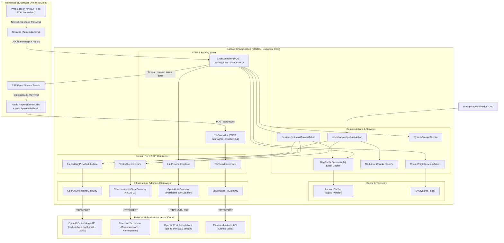

# Moisés Corcho — Systems Engineer & Full-Stack / AI Developer Portfolio

[](https://laravel.com)
[](https://php.net)
[](https://tailwindcss.com)
[](https://alpinejs.dev)
[](https://www.pinecone.io)
[](https://openai.com)
[](https://elevenlabs.io)
[-success?style=flat&logo=pest)](tests/)

Personal portfolio and professional showcase for **Moisés Corcho Pérez** (Systems Engineer, Full-Stack Developer & AI Developer). Built on a **Cyber-Industrial Neo-Brutalist Continuous Chassis** (V2) with an enterprise-grade, fully decoupled **RAG (Retrieval-Augmented Generation) Knowledge Engine** and bidirectional voice assistant.

---

## 🏛️ Architecture Overview

The system strictly adheres to **Pragmatic SOLID** design principles and clean architecture conventions, separating the domain model from external infrastructure dependencies.

```text
mcp-portfolio/
├── app/
│   ├── Actions/Rag/                  # Single-purpose domain verbs (Invokable)
│   │   ├── IndexKnowledgeBaseAction.php       # Ingests, chunks, embeds & upserts to Pinecone
│   │   ├── RecordRagInteractionAction.php     # Non-blocking MySQL telemetry persistence
│   │   └── RetrieveRelevantContextAction.php  # Cached embedding search + score threshold filter
│   ├── Contracts/Rag/                # Ports / Inversion of Control interfaces (DIP)
│   │   ├── EmbeddingProviderInterface.php     # Vector embedding generation contract
│   │   ├── LlmProviderInterface.php           # Non-streaming & streaming LLM contract
│   │   ├── VectorStoreInterface.php           # High-dimensional vector database contract
│   │   └── TtsProviderInterface.php           # Audio text-to-speech synthesis contract
│   ├── DTOs/Rag/                     # Immutable, typed data transfer objects (readonly)
│   │   ├── ChatMessageDTO.php                 # Role/content chat interaction payload
│   │   ├── ChatPromptDTO.php                  # Guardrailed LLM inference context + maxTokens
│   │   ├── DocumentChunkDTO.php               # Partitioned Markdown chunk with metadata
│   │   ├── RagInteractionLogDTO.php           # Structured Q&A log payload
│   │   ├── ScoredChunkDTO.php                 # Search match with similarity score
│   │   └── VectorRecordDTO.php                # High-dimensional vector + Pinecone payload
│   ├── Enums/Rag/                    # String-backed domain vocabularies (*Enum suffix)
│   │   ├── EmbeddingModelEnum.php             # text-embedding-3-small (1536) / large (3072)
│   │   ├── LlmModelEnum.php                   # gpt-4o-mini / gpt-4o
│   │   ├── MessageRoleEnum.php                # system / user / assistant
│   │   ├── RagBlockedReasonEnum.php           # empty_context
│   │   ├── RagDocumentTypeEnum.php            # project / experience / skill / general
│   │   └── RagLogStatusEnum.php               # completed / blocked / error
│   ├── Gateways/Rag/                 # Concrete infrastructure adapters implementing contracts
│   │   ├── OpenAiEmbeddingGateway.php         # OpenAI API v1/embeddings adapter
│   │   ├── OpenAiLlmGateway.php               # OpenAI chat completions & cURL stream adapter
│   │   ├── PineconeVectorStoreGateway.php     # Pinecone serverless REST data plane adapter
│   │   └── ElevenLabsTtsGateway.php           # ElevenLabs cloned voice synthesis adapter
│   ├── Http/Controllers/Rag/
│   │   ├── ChatController.php                 # SSE streaming, exact cache & short-circuit
│   │   └── TtsController.php                  # MP3 voice generation endpoint with caching
│   ├── Models/
│   │   └── RagLog.php                         # Eloquent model for rag_logs telemetry
│   ├── Console/Commands/
│   │   ├── RagEvaluateCommand.php             # artisan rag:evaluate (Golden dataset benchmark)
│   │   ├── RagIndexCommand.php                # artisan rag:index (Upsert + cache version bump)
│   │   └── RagLogsCommand.php                 # artisan rag:logs (Inspect DB Q&A interactions)
│   └── Services/Rag/
│       ├── MarkdownChunkerService.php         # Semantic Markdown partitioning by headings
│       ├── RagCacheService.php                # Versioned exact response & embedding cache
│       └── SystemPromptService.php            # 3rd-person persona, scope & anti-injection rules
├── storage/rag/knowledge/            # 12 structured Markdown dossiers
│   ├── 01-profile-and-capabilities.md
│   ├── 02-leenhoney-ecommerce.md
│   ├── 03-carfleet-saas.md
│   ├── 04-anime-recommender-ai.md
│   ├── 05-skytrack-flight-pwa.md
│   ├── 06-interval-timer-flutter.md
│   ├── 07-keep-coding-hackathon.md
│   ├── 08-inforeal-cms.md
│   ├── 09-amatu-cafe.md
│   ├── 10-videogame-and-pdf-tooling.md
│   ├── 11-career-leadership-and-interviews.md
│   └── 12-soft-skills-and-personal-profile.md
├── tests/
│   ├── Fixtures/Rag/
│   │   └── golden_dataset.json       # 20 Ground-truth test cases covering repos, skills & scope
│   └── Feature/Rag/
│       └── RagGoldenDatasetTest.php  # Automated retrieval accuracy test (Hit Rate @ 4)
└── resources/views/
    ├── components/v2/
    │   ├── rag-drawer.blade.php      # Cyber-Industrial HUD Drawer with Alpine.js streaming & STT/TTS
    │   ├── brand-logo.blade.php      # Feline laptop vector mark with organic idle cycle
    │   ├── extruded-box.blade.php    # 2.5D axonometric box with specular glint & press physics
    │   └── page-loader.blade.php     # System page loader with hardware-accelerated logo
    └── v2/sections/                  # Modular Continuous Chassis chambers (80-120 lines each)
```

---

## 🧠 RAG & Voice AI Engine: Complete Architecture & Data Flow

The following interactive diagram illustrates how the system's internal domain services, dependency inversion contracts (DIP), infrastructure gateways, and external cloud AI services communicate during both offline batch vectorization and real-time inference streaming:



### 🔄 The Three Core Workflows Explained

#### 1. Batch Vectorization & Ingestion (`sail artisan rag:index`)
1. **Source Dossiers:** Ingests 12 structured Markdown files from `storage/rag/knowledge/` representing Moisés's real repos, leadership scenarios, soft skills, personal interests, and boundaries.
2. **Semantic Partitioning:** `MarkdownChunkerService` parses files by H1/H2 boundaries, ensuring each chunk retains its `document_id`, `section`, and `document_title` metadata without slicing sentences across boundaries.
3. **Dense Vectorization:** `OpenAiEmbeddingGateway` invokes OpenAI's `text-embedding-3-small` in batches of 20, generating 1536-dimensional floating point vectors.
4. **Documents API Upsert & Cache Invalidation:** `PineconeVectorStoreGateway` formats records with unique IDs and flattens metadata, posting them in batches of 50 to `POST /namespaces/__default__/documents/upsert` with the mandatory `X-Pinecone-API-Version: 2026-07` header. `RagIndexCommand` then bumps the `rag:kb_version` cache key to invalidate stale cached responses and embeddings.

#### 2. Real-Time Semantic Retrieval, Guardrails & SSE Streaming (`POST /api/rag/chat`)
1. **Rate Limit & Exact Cache:** Protected by `throttle:10,1`. For first-turn queries (`history` empty), `ChatController` checks `RagCacheService` using normalized query hashes (`rag:resp:v{N}:{hash}`) and replays cached answers via SSE with zero OpenAI/Pinecone calls.
2. **Context Retrieval:** `RetrieveRelevantContextAction` checks cached embeddings first, embeds on cache miss, queries Pinecone (`topK = 4`), and filters out noise (`minScore >= 0.30`).
3. **Empty-Context Short-Circuit:** If retrieval returns `[]` on a first-turn query, `ChatController` short-circuits with a localized fallback (`home.rag_out_of_scope_fallback`) without calling OpenAI.
4. **Guardrailed Assembly & Token Cap:** `SystemPromptService` enforces 3rd-person tone, strict portfolio/personal-profile scope, anti-prompt-injection rules, and professional abuse deflection, while `ChatPromptDTO` caps output via `max_tokens = 600`.
5. **Non-Blocking SSE & Telemetry:** `OpenAiLlmGateway` streams tokens from `gpt-4o-mini` (`temperature: 0.2`) using a persistent cURL line buffer, emitting `context`, `token`, and `done` events. After completion, `RecordRagInteractionAction` persists anonymized telemetry (`session_hash`, `chunks_count`, `top_score`, `cache_hit`, `blocked_reason`, `latency_ms`, `status`) into `rag_logs`, inspectable via `php artisan rag:logs`.

#### 3. Voice Synthesis with Automated Fallback (`POST /api/rag/tts`)
1. **Primary Synthesis (ElevenLabs):** If configured, the frontend queries `POST /api/rag/tts`. `ElevenLabsTtsGateway` synthesizes audio using Moisés's cloned voice and returns an `audio/mpeg` stream.
2. **Zero-Crash Fallback (Browser Speech):** If the API key is unset, quotas are exhausted, or an HTTP 503 occurs, the frontend silently falls back to the browser's native `window.speechSynthesis`, providing a 100% reliable voice experience with zero external dependencies.

#### 4. Ground Truth Quality Assurance (`sail artisan rag:evaluate`)
The system includes a **Golden Dataset** benchmark (`tests/Fixtures/Rag/golden_dataset.json`) with 20 comprehensive test cases covering repositories, leadership, soft skills, personal profile, and negative boundaries. Running `sail artisan rag:evaluate` computes real-time retrieval metrics against Pinecone (`Hit Rate @ 4 >= 80%` threshold), backed by PHPUnit feature test `tests/Feature/Rag/RagGoldenDatasetTest.php`.

---

## 🚀 Core Features

### 1. Cyber-Industrial Continuous Chassis (`/`)
* **Monolithic Grid Spine:** A continuous 1280px (`max-w-7xl`) structural chassis running unbroken from navbar to footer with CAD reticles, corner pins, and coordinate grid planes.
* **Polymorphic 2.5D Extruded Boxes:** Axonometric structural cards and interactive buttons (`<x-v2.extruded-box>`) featuring realistic chiaroscuro facet shading, tactile press physics, and GPU-accelerated specular glass glint.
* **Zero "Sci-Fi Cosplay":** Free of fake pseudotext or mock coordinates; all technical telemetry and system labels reflect authentic architecture.
* **Internationalization:** Full dynamic localization (`lang/es/` and `lang/en/`) covering copy, project metadata, and CV details.

### 2. Enterprise AI Project Advisor (RAG & Voice HUD Drawer)
* **Grounded Semantic Retrieval:** Custom vector search over 12 structured Markdown dossiers detailing Moisés's real repositories, tech stacks, engineering decisions, soft skills, personal interests, and architectural scope.
* **Multi-Layer Guardrails & Exact Cache:** Empty-context short-circuiting, prompt-injection & off-topic rules, `max_tokens = 600` output cap, `throttle:10,1` rate limiting, versioned exact normalized cache (`rag:kb_version`), and non-blocking MySQL telemetry (`rag_logs` + `php artisan rag:logs`).
* **High-Performance Streaming (SSE):** Token-by-token streaming via Server-Sent Events (`POST /api/rag/chat`) with time-to-first-token (TTFT) under 50ms, accompanied by real-time source citations and similarity scores.
* **Bidirectional Voice Interface:**
  * **Speech-to-Text (STT):** Integrated Web Speech API for real-time microphone dictation at zero latency and zero API cost.
  * **Text-to-Speech (TTS):** Direct integration with **ElevenLabs** using Moisés's custom cloned voice, paired with an automated fallback to the browser's native speech synthesis when quotas expire or credentials are unset.

### 3. Dedicated Chambers & Legacy Archives
* **Retro Arcade Chamber (`/videogame`):** Dedicated showcase for *The Developer's Journey* and *But Why?...* (Game Jam Cultura Abierta 2025) with retro typography (*Press Start 2P*).
* **Legacy V1 Archive (`/v1`):** Complete historical preservation of Portfolio V1.

---

## ⚖️ Architectural Decisions & Industry Best Practices

### Why Pinecone instead of `pgvector` for this deployment?
1. **CloudPanel & VPS Simplicity:** Production runs containerized on a Hostinger Linux VPS managed with **CloudPanel**. CloudPanel is engineered specifically around MySQL / MariaDB (providing automated GUI backups, user management, and cron jobs).
2. **Infrastructure Isolation:** Running `pgvector` would require spinning up a secondary PostgreSQL instance outside CloudPanel's management scope, adding RAM overhead to the VPS.
3. **Decoupled Serverless Vector Store:** In modern enterprise architectures where MySQL serves OLTP traffic, offloading semantic search to a serverless vector database (**Pinecone**) is the standard pattern. It provides sub-30ms search latency, permanent free tier capacity, and zero server maintenance.
4. **Dependency Inversion (DIP):** Because the engine is programmed against `VectorStoreInterface`, migrating to `PgVectorStore` or `QdrantVectorStore` requires writing a single class and updating one line in `AppServiceProvider.php`.

### Why Server-Sent Events (SSE) instead of WebSockets?
* LLM completions are strictly one-directional streams from server to client.
* SSE runs over standard HTTP/1.1 or HTTP/2, requires zero stateful socket daemons (like Pusher or Laravel Reverb), works seamlessly through corporate proxies, and reconnects automatically.

### Why Web Speech API for STT + ElevenLabs for TTS?
* **Cost & Quota Protection:** Speech recognition happens client-side directly in the browser at 0 cost, saving OpenAI token credits.
* **Personalized Brand Experience:** ElevenLabs provides authentic voice cloning for recruiters and visitors, while the automated fallback ensures the application never crashes if the monthly quota is exhausted.

---

## 🔑 Environment Variables & API Keys

Create a `.env` file in the project root based on `.env.example`:

| Variable | Required | Description | Example / Default |
| :--- | :---: | :--- | :--- |
| `OPENAI_API_KEY` | **Yes** | OpenAI API key for `text-embedding-3-small` and `gpt-4o-mini` | `sk-proj-...` |
| `PINECONE_API_KEY` | **Yes** | Pinecone Data Plane API key | `pcsk_...` |
| `PINECONE_INDEX_NAME` | **Yes** | Target Pinecone vector index | `mcp-portfolio-rag` |
| `PINECONE_HOST` | **Yes** | Pinecone serverless host URL | `https://mcp-portfolio-rag-....pinecone.io` |
| `ELEVENLABS_API_KEY` | Optional | ElevenLabs API key for cloned voice synthesis | `sk_...` |
| `ELEVENLABS_VOICE_ID` | Optional | Voice ID of cloned voice in ElevenLabs | `21m00Tcm4TlvDq8ikWAM` |
| `ELEVENLABS_MODEL_ID` | Optional | ElevenLabs multilingual model | `eleven_multilingual_v2` |

> [!NOTE]
> The Pinecone index must be created with **Dimension: 1536** and **Metric: Cosine** to match the OpenAI `text-embedding-3-small` model.

---

## 🛠️ Local Development & Setup

### Prerequisites
* Docker & Docker Compose (or PHP 8.2+, Composer, Node.js 20+, MySQL 8.4+)
* Git

### Step-by-Step Installation

```bash
# 1. Clone the repository
git clone https://github.com/MoisesCorcho/mcp-portfolio.git
cd mcp-portfolio

# 2. Checkout main branch
git checkout main

# 3. Setup environment file
cp .env.example .env
# Edit .env and supply your OPENAI_API_KEY, PINECONE_*, and ELEVENLABS_* credentials

# 4. Install PHP dependencies
composer install

# 5. Generate application key
php artisan key:generate

# 6. Install Node dependencies and compile frontend assets
npm install
npm run build

# 7. Start environment (using Laravel Sail Docker)
./vendor/bin/sail up -d

# 8. Run database migrations & seeders
./vendor/bin/sail artisan migrate --seed
```

### Ingesting & Indexing the RAG Knowledge Base

To chunk the technical Markdown dossiers, generate embeddings with OpenAI, and index them into your Pinecone vector database, execute:

```bash
# Using Sail:
./vendor/bin/sail artisan rag:index

# Or native PHP:
php artisan rag:index
```

Output:
```text
Starting RAG Knowledge Base indexing...
  → Chunked 01-profile-and-capabilities.md (4 chunks)
  → Chunked 02-leenhoney-ecommerce.md (4 chunks)
  ...
  → Generated embeddings for batch 1/2
  → Successfully upserted 38 vector records into Pinecone.
Indexing completed! Total vector records indexed: 38
```

---

## 🧪 Testing Standard

The test suite covers unit domain models, gateway mock integrations, API streaming endpoints, and UI rendering:

```bash
# Run full test suite
php artisan test

# Run isolated RAG test suite
php artisan test --filter=Rag
```

Current test matrix (45 tests, 394 assertions):
* `Tests\Unit\ExampleTest`: Baseline unit assertion (1 test).
* `Tests\Unit\Rag\RagDomainTest`: DTOs, Enums, `maxTokens`, guardrail prompt rules (7 tests).
* `Tests\Unit\Rag\RagGatewaysTest`: Mocked OpenAI & Pinecone HTTP adapters, `max_tokens` payload, DI container binding (7 tests).
* `Tests\Unit\Rag\RagIndexingTest`: Markdown semantic chunking (including personal profile), upsert orchestration, cache version bump on `rag:index` (4 tests).
* `Tests\Feature\ExampleTest`: V2 root, `/videogame`, `/v1`, and 301 redirects (5 tests).
* `Tests\Feature\Rag\RagChatApiTest`: Embedding/response exact cache, history bypass, empty-context short-circuit, `rag_logs` persistence, `rag:logs` CLI, `throttle:10,1` (9 tests).
* `Tests\Feature\Rag\RagDrawerRenderTest`: Blade view rendering, HUD triggers, localization (1 test).
* `Tests\Feature\Rag\RagGoldenDatasetTest`: Golden dataset structure & Hit Rate @ 4 simulation across 20 cases (2 tests).
* `Tests\Feature\Rag\RagTtsTest`: ElevenLabs audio synthesis, 503 fallback handling (4 tests).
* `Tests\Feature\V2ExtrudedBoxTest`: 2.5D extruded box physics, CAD corner pins (5 tests).

---

## 🌐 Production Deployment (Hostinger VPS + CloudPanel)

```bash
# 1. Pull latest release on server
git pull origin main

# 2. Install production dependencies
composer install --no-dev --optimize-autoloader
npm ci && npm run build

# 3. Run pending database migrations (including rag_logs)
php artisan migrate --force

# 4. Cache configuration, routes, and views
php artisan config:cache
php artisan route:cache
php artisan view:cache

# 5. Synchronize RAG vector embeddings & bump cache version
php artisan rag:index

# 6. Restart PHP-FPM / Octane
systemctl restart php8.2-fpm
```

---

## 📄 License
This project is open-source software licensed under the [MIT License](LICENSE).
